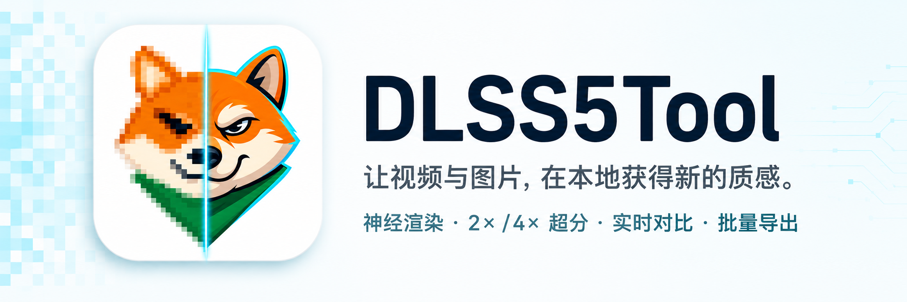
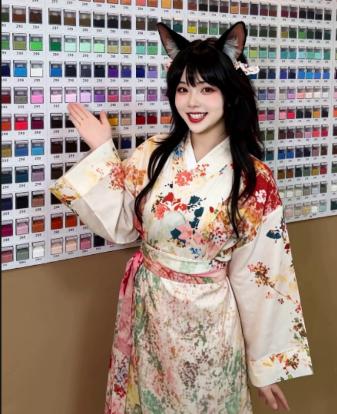
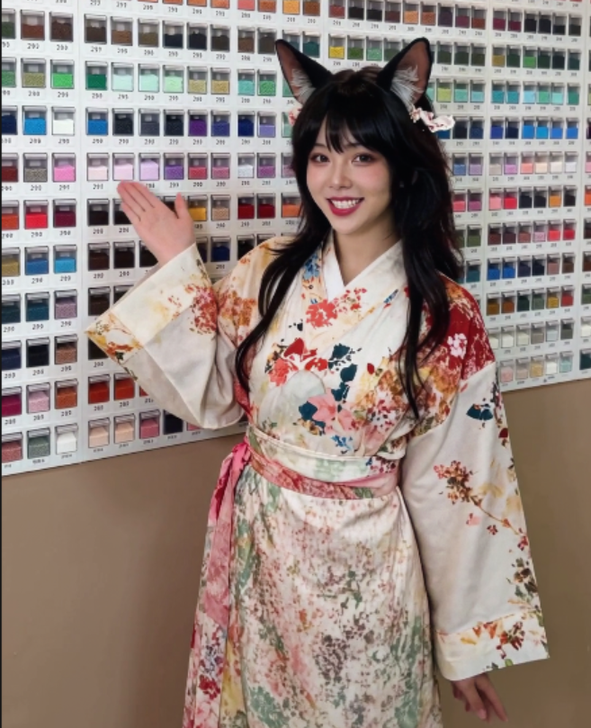
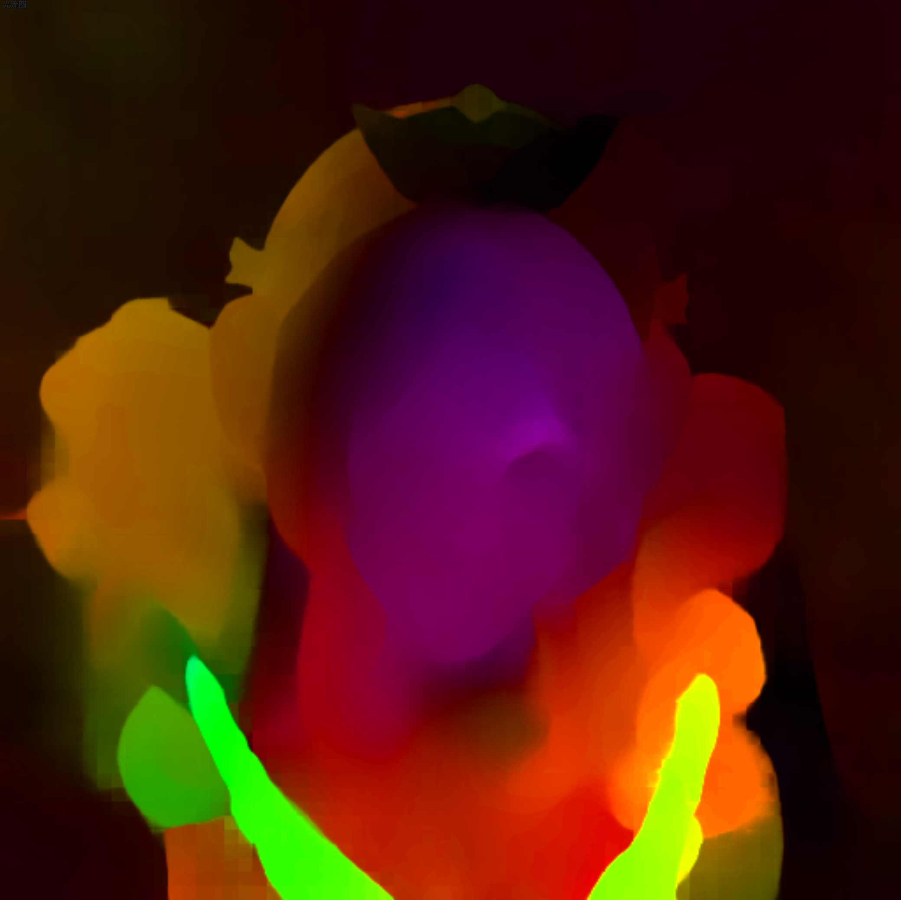
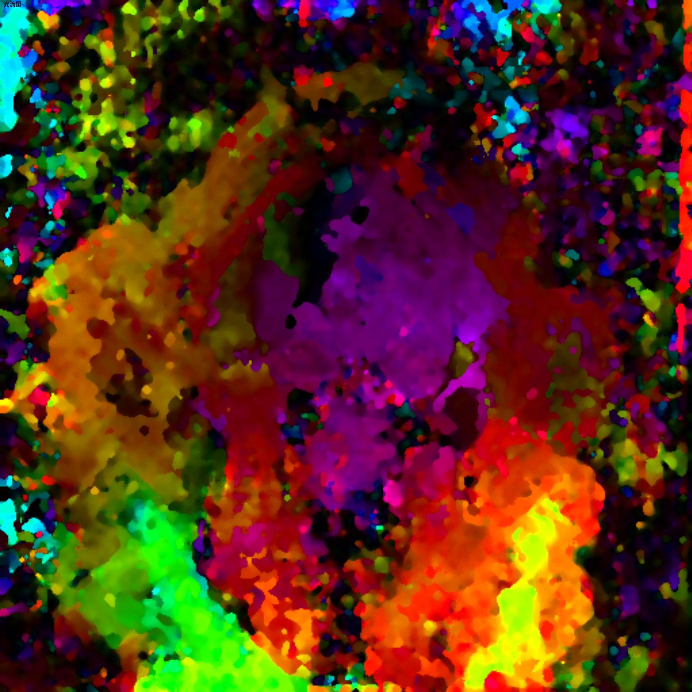

<h1 align="center">
  
</h1>

<p align="center">
  本地图片与视频处理 · 实时窗口增强，用一个工作台调节画面、对比效果。
</p>

<p align="center">
  <strong>简体中文</strong> ·
  <a href="README.en.md">English</a> ·
  <a href="https://github.com/banbanzhige/DLSS5Tool/releases/latest">下载免安装版</a> ·
  <a href="#快速开始">快速开始</a> ·
  <a href="CHANGELOG.md">更新日志</a>
</p>

<p align="center">
  <a href="CHANGELOG.md"></a>
  <a href="#快速开始"></a>
  <a href="#2-选择显卡运行库"></a>
  <a href="LICENSE"></a>
</p>

本文介绍 **v3.0.4** 本地打包版本，加入画面效果分组折叠、独立区域保护、硬件解码与导出优化。部分环境下的持续内存增长仍待解决。是否已公开下载以 Releases 实际附件为准。变化见 [更新说明](docs/release/RELEASE_NOTES_v3.0.4.md)，分发限制见[许可证](#许可证)。

## 功能概览

DLSS5Tool 将 **本地媒体处理与实时窗口增强** 放在同一个工作台，无需接入游戏引擎或使用采集卡。

- **本地图片与视频**：DLSS 5 神经渲染、原图分界／并排对比、逐帧查看，以及批量导出和图片序列转视频。
- **本地超分与插帧**：RTX Video 2× / 4× 超分；视频可导出 2× / 3× / 4× 插帧（后两者为实验模式）。
- **实时窗口增强**：选择正在运行的窗口，组合增强、缩放与插帧步骤，保存个人预设，并为固定区域设置保护；支持窗口／全屏输出。
- **更顺手的调节**：支持的参数可分组复制、恢复与撤销；调节时显示待处理、更新中或已生效状态。本地与实时配置独立保存，不会自动同步全部参数。
- **可选光流**：轻量版已含本地 NVOFA 硬件光流；需要 RAFT 时再安装完整版或推理附加包。
- **输出与资源管理**：本地支持 HDR10 / HLG 10-bit 及符合条件的 GPU 导出；两种模式协调显卡资源占用，并提供统一诊断。

点击右上角双向箭头、按 `Ctrl+Tab` 或通过「更多 → 工作模式」切换模式。界面支持简体中文 / English、浅色 / 暗色主题；通过「更多 → 语言」切换语言，重启后生效。

## 当前版本界面

### 本地媒体 · 对比与调参

<p align="center">
  <a href="img/v3.0.0-本地.png"></a>
</p>

### 实时增强 · 来源、方案与输出

<p align="center">
  <a href="img/v.3.0.0-实时.png"></a>
</p>

### 效果对比

同一张 AI 生成素材：左图未处理，右图为神经渲染结果。可用于观察材质、光影和细节的变化，不代表所有素材都能获得相同改善。
<table>
  <tr>
    <th width="50%">图 1 · 原图</th>
    <th width="50%">图 2 · 神经渲染后</th>
  </tr>
  <tr>
    <td align="center">
      <a href="img/01.png"></a>
    </td>
    <td align="center">
      <a href="img/02.png"></a>
    </td>
  </tr>
</table>


[▶ 观看 B 站介绍视频](https://www.bilibili.com/video/BV1yhaN6uEWB)（v2.3.3版演示，界面与操作以 v3.0.0 截图和使用指南为准，有空我再更新）。


## RAFT / NVOFA 光流对比

光流为连续画面增强提供运动参考，可能改善时序稳定性，但效果取决于素材。可先试轻量版自带的 NVOFA；需要比较 RAFT 的效果时，再安装推理附加包。在下述两段历史测试素材上，NVOFA 更快，质量差距并不大，不代表 v3.0.0 在所有场景都有同样收益。

<details>
<summary>展开光流截图与历史实测数据（2026-09-10）</summary>

开启光流图预览后可以直观看出运动估计情况，**颜色表示运动方向，亮度表示位移大小**。

<table>
  <tr>
    <th width="33%">07 · 原图 / DLSS 分界对比</th>
    <th width="33%">08 · RAFT 光流</th>
    <th width="33%">09 · NVOFA 光流</th>
  </tr>
  <tr>
    <td align="center"><a href="img/07.png"></a></td>
    <td align="center"><a href="img/08.png"></a></td>
    <td align="center"><a href="img/09.png"></a></td>
  </tr>
</table>

这组截图中，RAFT 的人物轮廓与大面积运动更连贯；NVOFA 在背景、头发和面部有更多碎块与局部方向变化。

### 实测数据

以下为 2026-09-10 在指定环境下的实测，不代表其他素材或配置的性能：RTX 4070 SUPER 12 GB / 驱动 616.64。分析长边 512，RAFT-Large 6 次更新 / FP32；NVOFA SLOW / 1×1 网格 / temporal hints 关闭。同参数 DLSS v2、原尺寸 SDR、缓存关闭、禁止回退；每片每后端运行 3 次并交换先后顺序，以下取中位数。

| 素材 | RAFT 整段耗时（有效 fps） | NVOFA 整段耗时（有效 fps） | NVOFA 耗时减少 |
| --- | ---: | ---: | ---: |
| 方形 1440×1440 · 165 帧 | 17.08 s（9.66） | 10.54 s（15.65） | 38.3% |
| 竖屏 1088×1920 · 243 帧 | 20.77 s（11.70） | 14.23 s（17.08） | 31.5% |

单独光流阶段（含输入准备、回读与尺寸恢复，不含 DLSS）的稳态耗时：方形 RAFT / NVOFA 为 **31.21 / 6.19 ms**，竖屏为 **23.21 / 5.29 ms**

| 质量代理指标 ↓（每片 39 对，8-bit RGB 灰度级） | 方形 RAFT | 方形 NVOFA | 竖屏 RAFT | 竖屏 NVOFA |
| --- | ---: | ---: | ---: | ---: |
| 光流回投 MAE · 相同有效区域 | 3.099 | 2.592 | 3.469 | 3.652 |
| DLSS 增强时序残差 · 固定 RAFT 参考 | 1.560 | 1.610 | 1.446 | 1.478 |
| DLSS 增强时序残差 · 固定 NVOFA 参考 | 1.516 | 1.424 | 1.394 | 1.391 |

**结论：本机两段素材上 NVOFA 更快，但画面质量差距并不大。**

测试范围、三轮波动、无光流基线与复现命令见[完整实测说明](docs/experiments/README_FLOW_BENCHMARK.md)，数值与组件哈希见[公开结果 JSON](docs/experiments/README_FLOW_BENCHMARK_20260910.json)。

</details>

## 快速开始

需要 **Windows 10 / 11 x64、兼容的 NVIDIA RTX 显卡及驱动**，以及 [Microsoft Visual C++ x64 运行库](https://learn.microsoft.com/cpp/windows/latest-supported-vc-redist)。显卡适配方式见第 2 步。

### 1. 下载并完整解压

前往 [Releases 下载免安装版](https://github.com/banbanzhige/DLSS5Tool/releases/latest)，不要选择页面底部的 `Source code` 源码包。

| 你的需求 | 选择哪个包 |
| --- | --- |
| 本地增强／超分／插帧、实时窗口增强、本地 NVOFA 硬件光流 | **轻量版（推荐）**：`DLSS5Tool-v版本号-win64.zip` |
| 还需要本地 RAFT 光流推理组件和模型 | **完整版**：`DLSS5Tool-v版本号-win64-full.zip.001` 起的所有分卷 |
| 已有同版本轻量版，只补装 RAFT | **推理附加包**：`DLSS5Tool-v版本号-win64-addon.zip.001` 起的所有分卷 |

- 完整版已包含附加包，不必重复下载。分卷请下载同一版本的全部文件，放在同一目录，用 7-Zip 打开 `.001` 解压。
- 附加包请在关闭程序后解压到 `DLSS5Tool.exe` 所在目录，不要套成 `mods/mods`。
- **完整解压到可写目录后再运行**，保持 `DLSS5Tool.exe` 与 `_internal` 目录在一起。无需另装 Python 或 FFmpeg。

### 2. 选择显卡运行库

提前确认自己的显卡型号；需要替换运行库时，前往单独的 [zip 下载页](https://github.com/banbanzhige/DLSS5Tool/releases/tag/zip)：

| 显卡 | 使用方式 |
| --- | --- |
| RTX 40 系 | 直接使用包内默认运行库 |
| RTX 30 系 | 在 zip 下载页下载 `30系.zip`，按下方说明放置 DLL |
| RTX 50 系 | 在 zip 下载页下载 `50系.zip`，按下方说明放置 DLL |

将匹配显卡的[nvngx_dlssnr.dll](https://github.com/banbanzhige/DLSS5Tool/releases/tag/zip)下载解压，请先关闭程序，将对应附件中的 `nvngx_dlssnr.dll` 放入程序同级的 `mods` 文件夹：

```text
mods\nvngx_dlssnr.dll
```

建议使用 `mods`，不要覆盖 `_internal` 中的内置 DLL，以免修改受管文件后无法使用增量更新。如果曾手动配置 DLL 路径，请一并检查设置。RTX 30 系使用社区适配运行库，兼容性取决于显卡与驱动组合，并非 NVIDIA 官方支持承诺。

### 3. 本地媒体：导入 → 对比 → 导出

1. 打开 `DLSS5Tool.exe`，拖入图片或视频，或点击「选择文件」。
2. 切换到「DLSS」或「对比」，在「画面效果」页选择风格、调整强度。按 `3` 可快速进入分界对比。
3. 在「画面效果」的导出区或「设置」页选择输出格式和画质；需要放大或插帧时再开启对应选项。超分 / 插帧旁的预览开关默认关闭，不影响导出。
4. 导出当前素材，或「加入队列」后批量处理。

首次使用可先保持默认设置，从短视频或单张图片试起。详细操作见[使用指南](docs/USER_GUIDE.md)。

### 4. 实时增强：选窗口 → 选方案 → 开始／停止

1. 打开需要增强的窗口，点击标题栏双向箭头或按 `Ctrl+Tab`，切换到「实时增强」。
2. 在「来源窗口」选择目标，选择并载入内置方案；首次建议使用「细节增强」与「窗口输出」。
3. 点击「开始增强」，等待实际输出画面出现，再按需调整参数；需确认应用的修改以界面提示为准。来源截图仅用于确认窗口与定位保护区域，不是实时效果预览。
4. 点击「停止增强」结束会话；默认紧急停止快捷键为 `Ctrl+Alt+F10`。使用全屏前先确认停止快捷键可用。

切回本地模式不会自动停止实时会话，底部状态栏仍提供停止入口。完整操作和兼容性边界见[实时使用说明](docs/REALTIME_USER_GUIDE.md)；真实游戏、HDR 和多显示器效果仍需在目标环境验证。

### 5. 图片序列转视频（可选）

在「队列 → 添加图片序列」只选一帧（例如 `frame_0001.png`）会补全该组连续编号图片；同组多选时仅导入选中的连续范围。同目录的其他完整序列会列出供你勾选。序列图片须具有相同前后缀、扩展名和尺寸。

- **设置原始帧率**：按素材实际帧率填写，再按需开启超分或插帧；输出为无音轨视频。
- **普通图片序列**：选择「SDR / sRGB」，使用 8 位、三通道 RGB PNG/JPG。
- **HDR 图片序列**：使用已按 PQ 或 HLG 编码的全范围 BT.2020、16 位三通道 RGB PNG，并在「输入图片色彩」选择对应类型。保留 HDR 导出需开启「HDR 高精度处理」。16 位不等于 HDR，不支持线性 EXR、HDR TIFF、灰度或带透明通道的 HDR 序列。

导入后若移动或修改原图，请重新导入。详细输入要求见[图片序列说明](docs/USER_GUIDE.md#图片序列)。

## 使用须知

- **效果与速度因素材和硬件而异**：交互对比不代表模型能实时处理。高分辨率、4× 超分、插帧和光流会增加耗时及显存占用。
- **插帧**：导出可选 2× / 3× / 4×；3× / 4× 为实验模式，可能出现运动偏差。超分与插帧预览默认关闭，不改变导出选择。
- **GPU 导出按条件启用**：是否使用 GPU 色彩转换和直连取决于显卡、组件、分辨率与编码设置；不符合条件的配置继续使用既有编码路径，不保证所有素材都有固定提速。可结合导出日志和一键诊断确认实际路径。
- **本地光流默认关闭**：在「推理模型」中按需启用。NVOFA 使用轻量版自带组件，仍需显卡与驱动支持；RAFT 需要完整版或同版本附加包。重启会记住选择，并在环境检查通过后恢复；失败会提示原因。光流支持视频 SDR 和 HDR 独立分析副本，不支持分块时序引导；静态图片自动跳过光流，不改动视频偏好。
- **模式互通不等于全部同步**：只复制界面明确支持的参数组，复制前确认覆盖范围；两边的配置、实时草稿和已排队任务不因切换而自动互相覆盖。渲染与资源释放仍需时间，请参考待处理、更新中及运行状态提示。
- **DLSS 渲染 GPU**：默认按高性能顺序使用 NVIDIA 显卡，显示器接在核显上时仍在独显上运行；多卡可在设置中指定。
- **本地 HDR 导出与预览**：导出写入 HDR10 / HLG 色彩标签（BT.2020、PQ/HLG、limited range）与 10-bit HEVC；本地界面预览仍映射为 SDR。不复制 Dolby Vision / HDR10+ 动态元数据。暂不支持单张静态 HDR 图片；HDR 图片序列要求见上文。详见[输出与画质说明](docs/USER_GUIDE.md#输出与画质说明)。

## 常见问题

**启动失败，或提示缺少 DLL？**

确认已完整解压，EXE 与 `_internal` 在一起，并安装 x64 Visual C++ 运行库；不要混用不同版本的程序文件。

如果运行的是 `Source code` 源码包，安装 Python 依赖并不会补齐原生 DLL，请按[开发指南](docs/development/BUILDING.md)准备运行环境。`missing dlssnr_host.dll` 也可能是找不到 v2 宿主后尝试旧版宿主的结果，不代表必须下载旧版 DLL。

**预览卡顿，或高倍率超分失败？**

先降低播放质量，尝试较小素材或 2× 超分，并暂时关闭可选光流。增大缓存不能加快尚未计算的首遍处理。

**如何更新？**

通过「关于 → 检查更新」，或直接下载 Release。本轮仅为 v3.0.3 准备到 v3.0.4 的轻量版／完整版增量；正式发布且附件齐全后，才可通过发布页或更新器获取。更早版本使用整包升级，不自动串联多个增量包。

轻量版对应 `lite` 更新包，已安装附加组件的版本对应 `full`。不要只替换 EXE，也不要把旧版本组件直接混入 v3.0.4；[历史省流量升级说明](docs/release/UPGRADE_v2.3.1.md)仅适用于其中明确列出的版本。

有匹配包时，更新器只下载当前安装形态的变化文件，校验后再次确认退出，由独立助手安装。没有匹配包时，轻量版可下载整包，完整版引导到发布页选择完整版或同版本轻量版＋附加包。没有更新助手的旧版请手动将新版完整解压到新目录；增量更新需发布页提供对应附件。详见[更新说明](docs/USER_GUIDE.md)。

若程序内下载失败，但浏览器能下载 `.dlssupdate`，可在「关于 → 安装本地更新包」选择该文件。文件名中的来源版本必须等于当前程序版本，`lite`／`full` 必须与当前安装形态一致。程序会从 GitHub API 取得该附件的官方 SHA-256，校验本地文件和旧版安装后再次询问是否退出安装；导入需要能访问 GitHub API。请勿自行解压更新包或覆盖程序文件。此入口需要新版程序自带的更新助手，旧版请先使用整包升级一次。

**仍然无法使用？**

通过「关于 → 导出诊断」生成报告，在 [Issues](https://github.com/banbanzhige/DLSS5Tool/issues) 附上软件版本、显卡、驱动、复现步骤及诊断日志。公开前请检查日志中的本地路径等隐私信息。


## 更多文档

- [使用指南](docs/USER_GUIDE.md)：快捷键、模型设置、导出说明与详细排障
- [实时增强指南](docs/REALTIME_USER_GUIDE.md)：来源窗口、方案、保护区域与停止操作
- [更新日志](CHANGELOG.md)
- [开发指南](docs/development/BUILDING.md) · [参与贡献](CONTRIBUTING.md) · [技术文档索引](docs/README.md)
- [安全问题反馈](SECURITY.md)

## 许可证

接入 Magpie / Veyra 实时模块后的组合源码采用 [GPLv3](LICENSE)，原有 MIT 版权和授权声明保留在 [原始 MIT 许可证](licenses/DLSS5Tool-original-MIT.txt)，不追溯撤销旧版本授权。NVIDIA SDK/运行库、FFmpeg 和 Python 依赖仍受各自条款约束。实时原生宿主当前用于本机验证，GPL 与 NVIDIA 专有组件的组合再分发审核尚未完成，不能据此公开发布二进制。详见 [THIRD_PARTY_NOTICES.md](THIRD_PARTY_NOTICES.md) 及 [实时来源说明](native/realtime/NOTICE.md)。
