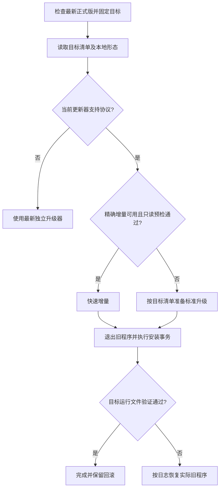

# 任意旧版本直达最新版：更新器设计

日期：2026-11-16。状态：设计完成，Velopack 已有可选实验接入；正式通道及历史 ZIP 迁移尚未切换。
验证结果、当前实现及正式启用前的剩余工作见 [Velopack 验证](VELOPACK_VALIDATION_20261116.md)。
不改变现有发行附件、schema 1 更新协议或 `previous-release` 策略。
代码依据：当前 v3.1.5 源码，检查版本时不推断 GitHub 尚未核实的公开发布状态。

## 目标与结论

在受支持的 Windows x64 环境中，允许不同旧便携版本一次升级到选定的最新正式版；
用户不必补装中间版本，维护者也不必为每个历史版本维护一份直达增量。
升级保持 lite/full 形态，保留设置、队列、用户模型和自定义组件，失败可恢复旧程序。

采用两个安装通道、同一个事务框架：

1. 有精确增量且运行基线可用：走现有快速增量。
2. 其他情况：走最新版目标清单驱动的标准升级，下载当前整包/组件，组装干净程序目录。

标准升级以“最终需要哪些官方文件”为准，不要求“当前所有文件必须属于某个完整旧版本”。
因此跨多版本、没有对应增量、旧核心文件损坏、旧版本号无法识别，都有可用的升级路径。
原有 `previous-release` 两个增量继续保留，作为节省流量的优化；不累计全部历史版本对增量，也不要求逐版安装应用。
可选框架内部允许用若干差分重建一个最终目标包，之后只安装一次；这不等于启动/安装每个中间版本。

## 体验参考与实施优先级

维护者认可 Cockpit Tools 的更新体验，已完成 [公开源码与发行机制核对](COCKPIT_UPDATER_COMPARISON_20261116.md)。
其 Windows NSIS 通道使用签名的完整安装器，支持可选后台下载及用户触发的重启安装。
本方案优先完成同类一键体验：后台检查、可选自动下载、清晰进度、取消/稍后/跳过版本、
下载就绪后安装、可恢复失败与手动兜底；极致块级差分作为后续流量优化。

自动下载尊重用户设置，默认不因后台检查就下载数 GB 组件。下载与 GPU 处理分离，
真正替换程序前等待导出/队列和工作进程退出，不能中断正在进行的用户任务。
内部统一使用检查、可更新、下载中、就绪、安装中、完成/可恢复失败状态，并对过期下载回调隔离。
下载就绪记录须可验证地持久化，重启后根据实际文件和摘要恢复，不能只依赖窗口内存状态。

可评估成熟框架承担应用核心的安装更新：Python 项目先验证 Velopack 的适配成本和兼容矩阵；
Tauri updater 作为交互/分发参考。实际引擎选型尚未改变，不能声称框架迁移已完成。

## 当前限制及要改变的位置

- `updater.fetch_latest_release` 已能取得最新正式 Release。
- `delta_update.select_asset` 只选择精确的当前版本 → 目标版本、lite/full `.dlssupdate`。
- `gui.App._prompt_for_update` 找不到增量时，lite 只下载便携 ZIP，full 打开发布页；尚无自动整包安装事务。
- `delta_update.prepare/apply_transaction` 的 schema 1 强依赖官方 before 清单，适合已知版本对。
- `update_helper` 当前执行旧安装自带的助手，不能让历史旧 EXE 自动获得未来协议。
- `package_editions` 已有 lite/full/addon、逐文件清单、分卷和摘要，是标准升级的数据基础。

新标准升级单独定义目标协议，不能伪造 schema 1 的 from 版本或删空 before 来绕过校验。

## 路由逻辑

初次预检、路由及容量计算完成后再向用户显示方案与下载量。正常情况下只确认一次下载、一次退出安装。
选择后的版本、形态、清单和附件摘要全部固定；下载期间新发布版本不改变当前事务。
同版本默认不重复更新，可提供明确的“修复安装”；默认不降级。

只有“没有匹配增量”或“本地运行文件不满足增量前提”转标准升级。
远端清单无效、下载摘要不符、路径非法、协议不支持等错误直接停止，不能借切换通道绕过。

## 老更新器如何进入新流程

首次引入时提供独立 `DLSS5Upgrade.exe`，使用当前标准库/独立冻结环境，不依赖旧程序的 Python、
`_internal` 或原有 `DLSS5Update.exe`。用户关闭旧程序，选择安装目录后，可直接安装目标最新版。
无更新助手、旧更新助手不认识新协议、原程序已经无法启动，均使用这一入口。

已经公开的旧更新器不会自动学会新逻辑。第一批历史用户需要运行一次独立升级器，
或者用首次含新更新器的整包完成迁移；这是跨旧协议的明确桥接边界。
安装新更新器后，后续版本使用统一的程序内升级入口。

新协议保留稳定的基础安装能力；每次发行必须用“首次通用版的旧冻结助手”验证安装当前最新版。
若未来确实需要提高协议最低版本，显示最新独立升级器入口。第一期不下载后自动执行新引擎，
也不执行更新包中的安装脚本；新版助手作为应用文件安装，供下次更新使用。

## 最新版清单与发布资产

新增一个目标版本清单资产，例如 `DLSS5Tool-vX.Y.Z-update-manifest.json`，包含：

| 字段 | 用途 |
| --- | --- |
| schema、目标版本、平台、最低更新协议 | 决定当前引擎能否执行；禁止平台猜测 |
| lite/full 的目标文件清单 | 路径、大小、SHA256、运行文件/文档/可替换运行库等角色 |
| 组件 ID、协议、文件/模型摘要 | 验证旧组件能否继续复用，保持 full 能力 |
| 下载来源与附件集合 | 严格匹配同一仓库、同一 tag、同一形态的官方附件名、大小、摘要和分卷顺序 |
| 解压大小、文件数量及可选设置迁移版本 | 预检空间、限制解压、校验声明的兼容范围 |

清单生成自最终已验收 lite/full 目录，不能从用户安装或历史实验目录取数据。
先用正式 Release API 的合法附件 SHA256 验证清单，再信任其中的目标文件和归档映射。
保留当前官方 GitHub HTTPS/API 摘要的信任模型；该模型不宣称独立于仓库账号的签名保障。
不得允许清单扩展到设置/队列、仓库外路径或任意用户文件；客户端仍有固定路径边界。

第一期复用现有官方 lite ZIP、full/addon 分卷，不引入逐文件上千个 GitHub 附件。
标准升级支持当前分卷规则：每卷单独验摘要，再按明确顺序拼接验证和解压；不能把 full 自动替换成 lite。
最新版清单和独立升级器成为新流程的必需资产，实施时一并加入打包报告和上传集合门禁。
本设计不授权上传，也不修改/补发现有正式 Release 附件。

## 如何准备目标程序

从可信目标清单生成一个干净候选；每个运行文件按以下顺序取得：

1. 本地内容与目标摘要完全相同且是安全普通文件时，可以复用其字节。
2. 其他文件从已验证的最新版归档/组件读取；复用失败就取官方目标字节，不依赖旧版本官方基线。
3. 候选形成后，逐项验证所有必需运行文件及组件协议。

第一期标准升级允许下载整个目标归档，保证直达；“本地复用”不代表 GitHub 能按压缩包内文件只传几 MB。
第二期再把稳定依赖、应用核心、推理组件和模型拆成可独立复用的下载单元，按摘要复用，减少重复下载。
不能以“任意版本直达”为理由承诺第一期所有版本都只下载最小差异。

对于 full，只有目标清单中模型/组件摘要完全匹配且协议兼容，才复用当前组件。
模型没变就保持原位置、避免复制整套 Torch/CUDA 或模型；组件变了则更新需要变化的组件。
对目录外自定义组件只做兼容检查，不越界改写；不兼容时明确说明需要更新的组件及下载量，不能静默降级。

## 文件与用户数据处理

| 类型 | 标准升级规则 |
| --- | --- |
| 官方主程序、助手、内置依赖、运行配置 | 以目标官方字节重建；现有字节不同也可升级，先保留实际旧内容用于回滚 |
| `_internal` 内未知旧代码/DLL/资源 | 留在旧目录的回滚副本中，不能简单覆盖解压后让残留文件继续参与运行 |
| README、更新日志、许可与使用说明 | 按已实现的非阻断文档策略处理，保护本地修改，不作为升级前提 |
| 设置、队列、输出、日志、用户自定义 DLL/模型 | 不被官方清单覆盖或清理；原路径优先保留 |
| 官方可选组件/模型与用户自定义文件混放目录 | 按可信受管路径清单更新官方内容，不整目录覆盖 mods |

自定义内置 DLSS 运行库需要显式的可替换运行库规则：只有目标允许且兼容时保留；
其他情况提供保留自定义副本的迁移方案，经用户选择后处理，不能当作损坏 DLL 静默覆盖。
这类自定义组件冲突、空间/权限不足仍可能需要用户处理；“所有旧版本可升级”不意味着可以忽略环境条件。

用户设置和队列的跨版本迁移由新版应用的受测迁移逻辑负责，先保存小型原始副本、原子写入、失败保留原文件。
更新器不执行网络下载的迁移脚本。需要特别覆盖 v2.x → v3.x、缺失字段和未知字段保留。

## 安装事务与恢复

标准升级复用现有事务锁、父进程等待、路径验证和逐项刷盘日志，但回滚依据改为
“此次安装前实际存在的文件/目录”，不是某个历史发行包的 before 哈希。

准备好完整候选并验收后，再退出旧程序及其工作进程。保持一次一个候选、一个回滚版本。
`_internal` 采用干净目录候选与旧目录轮换，避免残留 DLL 混装；根目录 EXE/助手按日志替换。
每个移动/替换前写意图，恢复时识别实际完成状态，允许在断电或进程异常退出后重试恢复。
不能把多文件/多目录安装声称为一次原子操作，也不能只记录最后一个 rename。

新主程序继续拒绝进入未完成的安装；针对不认识事务标记的古老主程序，独立升级器明确要求更新期间保持关闭，
并在替换前复查运行状态与文件占用。替换失败恢复已完成步骤，不能继续启动半套程序。
提供用户明确触发的“退出并更新”和“重启并更新”路径；后一操作包含退出、安装、启动已验证新版的授权。
仅检查、下载或选择稍后时不运行新主程序；安装来源与目标运行文件验证完成后才处理启动。
不执行更新包中的自定义脚本；回滚目录不自动清理。

空间预算包含下载、分卷重组、候选目录、仍存在的原程序/回滚和暂存，至少保留峰值外 15 GiB 安全余量。
复用经过摘要校验的只读输入；不能用可写硬链接/目录联接冒充隔离候选。
旧基线和用户安装不是临时缓存，不因这项升级而自动迁移/删除。

## 实施顺序

1. **先完成可靠直达**：目标清单、通道规划器、标准安装事务、完整归档/分卷读取、独立升级入口和 GUI 接入。
   保留现有 previous-release 增量；已有 lite/full 增量和上传检查不能被此功能替代或省略。
2. **再优化下载量**：以目标组件摘要选择复用/下载，拆分稳定依赖和模型下载单元；增加经过完整摘要验证的下载缓存。

建议新增 `update_plan.py` 负责只读路由和空间计划，`universal_update.py` 负责目标安装协议，
`release_manifest.py` 负责生成/验证发布清单；扩展 `update_helper.py` 与 `gui.py` 的安装入口。
schema 1 的增量模块继续负责已知版本对，不把两种事务混在一个巨大函数里。

## 发布验收门禁

| 场景 | 必须结果 |
| --- | --- |
| 上一正式版、准确增量、健康运行基线 | 快速增量升级，保持现有验证 |
| 多个历史版本、没有直达增量、lite/full | 标准升级直接到目标，保持形态 |
| 无助手的古老版本、旧主程序无法启动、版本未知 | 最新独立升级器仍可准备目标；未知目录先确认安装根与形态 |
| 官方主程序/DLL 缺失或改变 | 标准升级修复目标，实际旧内容可恢复 |
| README/许可缺失、删改、只读 | 不阻断运行文件升级 |
| 用户模型、自定义 DLL、设置、队列与输出 | 字节保留；必要设置迁移有原始副本 |
| 兼容/不兼容的旧 full 组件 | 正确复用或更新，不静默降级 |
| 伪造路径、链接、归档多余项、错误摘要或分卷缺失 | 修改安装之前拒绝 |
| 下载取消、空间不足、文件占用、逐操作异常退出 | 旧程序仍可运行，或有明确可重试的恢复事务 |
| 首次通用版旧冻结助手 → 以后每个目标 | 实际安装通过；不能只测最新源代码或最新助手 |

合成夹具覆盖全部路由与故障点；真实发行选取一个无助手旧版、一个中间版本、上一正式版及 lite/full 验证。
一次只保留一份真实安装验证副本，不为每个历史版本复制整套环境。
所有正式目标文件/组件一致，用户数据和回滚验证通过后，才将通用升级资产纳入可发布集合。
